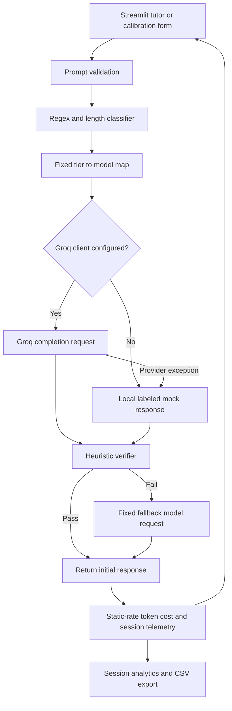
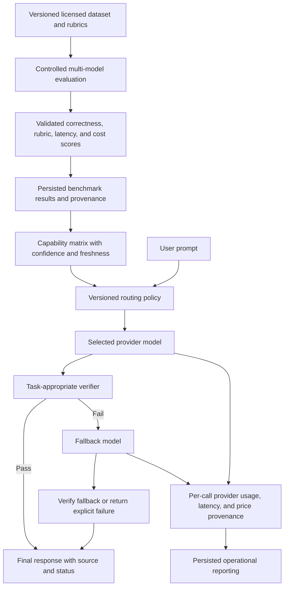

# EduRoute Implementation Audit

**Audit date:** 2026-10-10  
**Scope:** Repository state at audit time; code inspection, local deterministic tests, import/compile checks, and local Streamlit startup.  
**Method:** No application code or configuration was changed as part of this audit. No live inference request was sent to Groq.

## 1. Executive Summary

EduRoute is a runnable Streamlit prototype with an integrated deterministic, keyword-based tier classifier, Groq client wrapper, heuristic response verifier, fallback orchestration, and in-memory session cost telemetry. The tutor, fallback path, calibration tier-comparison form, and session analytics UI all have successful local/mock-mode checks.

The implementation does **not** meet the broader benchmark/calibration design described in the project prompt. Calibration currently compares the classifier's tier with a user-selected expected tier. It does not request a ground-truth answer or rubric, compare multiple selected models, score answer quality, select a winner, or update a capability matrix. There is no dataset or training pipeline. Verification checks output length and a few text markers, not factual correctness. The application has no durable telemetry or calibration persistence.

**Current demo readiness:** Ready with limitations for a local/mock or routing-workflow demonstration. Live Groq inference for the current configuration was not verified in this audit. Do not present the cost proxy as a measured saving, the multiplier as actual student capacity, or session activity as measured SDG 4/8 impact.

**Actual Data → AI → Impact flow:** A user-entered prompt goes through regex and prompt-length tier rules, then a fixed tier-to-model mapping. The selected Groq model is called if a client is configured; otherwise the client returns a labeled mock response. A word-count/keyword verifier may trigger a second call to a fixed fallback model. Token counts and configured rates feed per-request estimates held in the current Streamlit session. No external dataset, trained classifier, observed capability data, learning outcome, or employment outcome participates in the flow.

### Status count

The feature matrix contains **50 individually assessed requirements**:

| Status | Count |
|---|---:|
| Verified | 12 |
| Partial | 23 |
| Broken | 0 |
| Missing | 13 |
| Not Verified | 2 |

Status terms follow the definitions in the audit request. “Verified” is limited to functionality supported by code inspection and a successful relevant local test; it does not imply live-provider validation.

## 2. Project Structure

```text
.
├── .streamlit/
│   └── config.toml             # Theme and toolbar settings
├── app/
│   ├── __init__.py
│   ├── components.py           # Shared Streamlit presentation helpers
│   ├── demo_data.py            # Sample prompts and explicitly non-live placeholder values
│   ├── main.py                 # Navigation, tutor, calibration, analytics, and About UI
│   └── styles.py               # Shared CSS
├── core/
│   ├── __init__.py             # Public classifier and verifier exports
│   ├── classifer.py            # Rule-based educational prompt classifier (legacy misspelling)
│   ├── classifier.py           # Correctly spelled re-export alias
│   ├── profiler.py             # Empty file (0 bytes)
│   └── verifier.py             # Heuristic response verifier
├── engine/
│   ├── __init__.py             # Engine public exports
│   ├── model_client.py         # Groq client, token/latency capture, mock fallback
│   ├── router.py               # Tier mapping, verification, fallback, telemetry integration
│   └── telemetry.py            # Static token pricing and in-memory cost aggregation
├── tests/
│   ├── test_app_integration.py # Streamlit AppTest coverage for tutor/calibration/analytics
│   ├── test_engine.py          # Script-style model client and telemetry checks
│   └── test_router.py          # Script-style routing demonstration and assertions
├── .gitignore
├── ENGINE_SPECS_HANDOFF.md     # Backend handoff/specification document
├── HANDOFF_PERSON_3.md         # Older handoff/architecture document
├── README.md
└── requirements.txt
```

No tracked dataset, model-training artifact, benchmark corpus, database migration, lock file, `pyproject.toml`, `.env.example`, or audit report existed before this audit. A local `.env` file is present and ignored by Git. The configured-key check returned only a Boolean; no secret value was inspected or printed in the report.

### Structure and maintainability observations

- Separation between UI (`app`), core classification/verification (`core`), and provider/routing/telemetry (`engine`) is recognizable and imports succeed.
- `core/classifer.py` is the sole classifier implementation; `core/classifier.py` is an alias, not a duplicate implementation.
- `core/profiler.py` is empty, despite being listed as a forthcoming profiler in handoff documentation.
- `app/demo_data.py` is explicitly sample-only and is not imported by the current app entry point.
- `HANDOFF_PERSON_3.md` contains a historical absolute path, lists only two tests, and describes UI/profiler files as open work although they now exist. Treat it as stale handoff context, not an authoritative inventory.
- `ENGINE_SPECS_HANDOFF.md` describes the current engine modules but includes claims such as “exact pricing” and guaranteed non-crashing behavior that are stronger than this audit can establish.
- `README.md` documents direct script commands. The `test_engine.py` script calls `generate()` directly and can use a configured Groq key; it is not inherently offline-safe when run as documented.

## 3. Feature Status Matrix

| # | Feature / requirement | Status | Evidence | Problem / gap | Required action |
|---:|---|---|---|---|---|
| 1 | Production tutor accepts a prompt and passes it through the router | Verified | `app/main.py::_render_tutor`; `test_tutor_submits_question_and_displays_router_result` | Verified in local/mock integration, not a live-provider acceptance test | Keep an offline integration test and add a separately gated live smoke test |
| 2 | Calibration Studio is usable from the UI | Partial | `app/main.py::_render_calibration_studio`; `test_calibration_evaluates_route_and_records_tier_agreement` | Submits one prompt and compares the chosen tier only | Expand it to evaluate model responses against an explicit rubric/answer |
| 3 | User can provide expected answer or evaluation rubric | Missing | Calibration form contains prompt and expected tier fields only | There is no ground-truth answer or rubric input | Add explicit answer/rubric fields and validation |
| 4 | Calibration executes multiple user-selected models | Missing | Form submits to `ProductionRouter.route_and_execute` once | Router selects a single initial model and possibly its fixed fallback | Add controlled per-model execution and comparison workflow |
| 5 | Classifier returns Tier 1, Tier 2, and Tier 3 | Verified | `core/classifer.py::EducationalQueryClassifier.classify`; mock router demonstration asserts all three tiers | Classification correctness beyond built-in examples is not measured | Add representative classifier unit tests and labeled evaluation |
| 6 | Classification features are deterministic and inspectable | Verified | Regex pattern lists and word-count thresholds in `core/classifer.py` | Rules are a limited heuristic, not semantic intent detection | Document limits and test overlaps/boundaries |
| 7 | Intent labels and calibrated confidence scores are produced | Missing | `classify_with_metadata` returns tier, descriptive tier name, target model, and prompt word count only | No intent taxonomy or confidence value is computed | Define and validate an explicit intent/confidence schema if required |
| 8 | Classifier training pipeline exists | Missing | No training code, model artifact, or training dataset in tracked project files | Classifier is hand-authored rules, not a trained ML classifier | Add only if evidence supports a trained classifier; otherwise label rules accurately |
| 9 | Routing uses classification to select an initial model | Verified | `engine/router.py::TIER_MODEL_MAP`; tier routing checked by mock router demonstration | Mapping is hardcoded and independent of measured model performance | Add policy/configuration only after reliable evaluation data exists |
| 10 | Capability matrix informs routing | Missing | No capability matrix implementation or persisted observations found | Current mapping is static | Implement observed benchmark storage and explicitly connect it to policy |
| 11 | Current configured Groq models successfully perform live inference | Not Verified | `engine/model_client.py::generate` contains a Groq call; no provider request was made in this audit | Current successful live response and current provider availability are not established. Recent supplied logs showed a Groq 429 on Qwen before the 900-token cap was added; the changed request has not been verified live | Run a separately authorized, low-volume live smoke test and record model, timestamp, and provider response without logging credentials |
| 12 | Supported model IDs match currently available provider models | Partial | `engine/model_client.py::SUPPORTED_MODELS`, `engine/router.py::TIER_MODEL_MAP`, and `FALLBACK_MODEL` | Code defines `openai/gpt-oss-20b`, `qwen/qwen3.8-27b`, and `openai/gpt-oss-120b`; live support is not fully confirmed in this audit | Verify each configured ID against the provider's current model catalog and add a gated contract test |
| 13 | Intended model pool and distinct model families are represented | Partial | The configured list has two `openai/gpt-oss` IDs and one Qwen ID | The intended Llama 3.1 8B and Llama 3.3 70B models are absent; configured pool represents two named families, not the requested Llama pool | Decide the intended model pool and align implementation and product documentation |
| 14 | API errors and invalid responses are handled | Partial | `engine/model_client.py::generate` catches provider-call exceptions and returns a marked mock response | Broad exception handling can turn programming/configuration errors into success-shaped mock output; empty provider content is returned to the verifier rather than rejected in the client | Narrow and categorize provider errors, preserve failure provenance, validate response shape, and test rate-limit/auth/empty responses |
| 15 | Provider timeouts are controlled and tested | Partial | Groq SDK call has no explicit timeout argument or app-level timeout configuration | Behavior falls back only after SDK/provider exceptions; timeout policy is not project-controlled or directly tested | Set an explicit timeout and test timeout behavior |
| 16 | Token counts have trustworthy provenance | Partial | Live path reads `response.usage`; mock path estimates from whitespace word counts | Dashboard/history does not distinguish estimated mock tokens from provider-reported tokens in the counts themselves | Persist/display token source per model call and exclude estimated values from “actual” aggregates |
| 17 | Benchmark can run across multiple selected models | Missing | No benchmark runner or model-selection controls in the calibration UI | Only one routed model and any automatic fallback are run | Implement a benchmark runner with bounded, explicit model choices |
| 18 | Model outputs are evaluated against ground truth | Missing | No ground-truth answer input or comparison logic found | No correctness or answer-equivalence scoring | Add a task-appropriate evaluation against user-provided/reference answers |
| 19 | Semantic similarity is calculated | Missing | No embedding/similarity evaluator or associated dependency found | No semantic quality score exists | Add a justified metric, reference set, and validation if needed |
| 20 | Formatting/rubric adherence is scored | Missing | Verifier checks word count and a small set of markers only | No rubric or format evaluator exists | Implement rubric-specific checks with test cases |
| 21 | Benchmark latency and cost comparisons are meaningful | Partial | Router records summed per-model latency and computes estimated cost | This is per-route operational telemetry, not a benchmark comparison across equivalent tasks/models | Compare equivalent prompts/rubrics across selected models and record the measurement boundary |
| 22 | A winning model is selected using a consistent score | Missing | No scoring formula or winner selection in the calibration implementation | Calibration history only counts tier matches | Define and validate a quality/cost/latency scoring policy before selecting winners |
| 23 | Calibration updates a capability matrix used by routing | Missing | No matrix or update logic found | Evaluation results do not change future routing behavior | Persist validated evaluation outcomes and deliberately integrate them into policy |
| 24 | Calibration results survive app restart | Partial | Results are held in `st.session_state["calibration_results"]` | Session-scoped memory is not durable storage | Add explicit persistence if cross-session history is a requirement |
| 25 | Public evaluation dataset is loaded and used | Missing | No dataset files or dataset loader are present in tracked project files | No public dataset participates in training or evaluation | Select an appropriately licensed dataset and document its use, version, and license |
| 26 | Verifier inspects generated output | Partial | `core/verifier.py::LightweightVerifier.verify` inspects response text | Checks are structural heuristics, not factual verification | Describe as sanity checking, or add validated correctness evaluation |
| 27 | Verification rules are appropriate to task complexity | Partial | Tier-specific minimum word counts; Tier 3 looks for one proof marker | Rules do not assess subject matter and may not fit short/correct answers | Build task-aware tests and use rubric-based validation where needed |
| 28 | Verifier reliably prevents false rejection and false acceptance | Partial | Verifier accepts responses based on word count/markers and rejects certain short/marker-free text | Plausible but incorrect long answers can pass; concise correct answers can fail | Measure false-positive/false-negative rates on labeled examples before describing verification as quality assurance |
| 29 | Failed initial verification invokes the fallback model | Verified | `engine/router.py::route_and_execute`; deterministic router demo asserts escalation | Verified orchestration with the mock provider, not successful live fallback availability | Keep fallback-path regression tests and separately validate the live provider |
| 30 | Both initial and fallback calls are included in cost telemetry | Verified | Router passes both model calls to `TelemetryTracker.calculate_route_savings`; fallback aggregation test passes | Cost values remain dependent on the accuracy of static rates and token provenance | Preserve aggregation and validate rates/provenance separately |
| 31 | Fallback reason is retained and shown to the user | Partial | Router returns reason in `impact_metrics`; tutor caption renders it | Telemetry history/CSV does not include `fallback_reason`; calibration history does not retain it | Add reason to persisted telemetry/report rows and test its UI display |
| 32 | Failed fallback request is safely represented | Partial | `generate()` returns mock output on provider exceptions and router returns that output | Fallback response is not re-verified; API failure can be represented as a returned answer and session success | Re-verify fallback output and distinguish request failure from successful inference in UI/telemetry |
| 33 | Actual input/output tokens are recorded for every route | Partial | Provider usage is read when present; fallback call token counts are accumulated | Mock counts are estimates, and source is not tracked on each call | Record actual/estimated provenance and test both provider response variants |
| 34 | Model prices match current provider pricing | Not Verified | Static values in `engine/telemetry.py::PRICING_PER_1M`; handoff states values | No authoritative current price source, effective date, currency, or live billing comparison is present | Verify against a dated provider price source and maintain pricing provenance |
| 35 | Per-route cost arithmetic follows the configured rates | Verified | `engine/telemetry.py::calculate_route_savings`; exact expected calculations pass in `test_telemetry_calculations` and fallback aggregation test | Arithmetic verification does not validate the rates themselves | Preserve unit tests and add rate-source validation |
| 36 | Baseline is documented and configurable | Partial | Static `BASELINE_MODEL` points to “Frontier Baseline (GPT-4o proxy)” | Baseline/rates are not user-configurable; source and equivalence assumptions are not stated in code | Add dated provenance and explicit configuration if comparison use requires it |
| 37 | Savings and percentage formulas are correct for the configured inputs | Verified | `dollars_saved = baseline - actual`; percentage uses baseline denominator; tested | Correct arithmetic does not establish that baseline is representative | Present only as an estimate against the named configured proxy |
| 38 | Latency is measured with a consistent end-to-end boundary | Partial | Client measures each call; router sums initial and fallback latencies | Classifier, verification, and UI overhead are excluded although tutor copy labels the value “End-to-end model latency”; `start_time` in router is not used | Rename the metric to model-call latency or time the full routing transaction |
| 39 | Cumulative session metrics update accurately | Verified | `TelemetryTracker` accumulates route totals; focused telemetry tests pass | Metrics are memory-only and reset with the session/process | Keep aggregation tests and document session scope |
| 40 | Accessibility multiplier reflects actual student capacity | Partial | `calculate_edtech_multiplier` divides baseline proxy cost by actual cost | It assumes equal quality and proportionally scalable costs; no student/access data or quality-retention measurement exists | Label as cost ratio only, or validate quality and capacity assumptions before making access claims |
| 41 | Analytics charts and KPI values use observed session events | Verified | `app/main.py::_render_sdg_analytics` reads `query_history`; AppTest renders after a routed request | These are current-session router records, not institution-wide or outcome metrics | Preserve session scope in all labels and exports |
| 42 | Mock and live results are distinguishable in the UI | Verified | Model client sets `mock_fallback`; tutor displays a simulated-response message; analytics exports a simulated flag | A provider failure can also produce mock output, which can be confused with an inference success without structured status | Keep labels and introduce a distinct inference/request status |
| 43 | Navigation, presets, and all UI controls work | Partial | AppTest exercises tutor, calibration, and analytics navigation and selected controls | Welcome/About/mobile menu and every scenario/button are not comprehensively tested | Add UI coverage for all navigation destinations and primary actions |
| 44 | Errors and loading states communicate failure appropriately | Partial | Tutor/calibration use spinners and catch request exceptions with generic user messages | Broad catch blocks conceal failure categories from users; model client converts errors to mock responses | Expose actionable sanitized provider status and preserve structured error state |
| 45 | UI displays selected/final model, verification, fallback, and impact | Partial | Tutor displays initial tier/model in route path, final model on escalation, latency/cost/fallback metrics | No explicit passed/failed verification result for a direct route; model-call source/status is not fully displayed | Return and render structured verification and inference statuses |
| 46 | Calibration UI reflects backend results faithfully | Partial | Records expected tier, router tier, route, escalation, latency, and estimated cost | It evaluates classifier-tier agreement only, not response or model quality | Keep the current label precise and extend only with real benchmark scores |
| 47 | Dashboard refreshes when a query is run | Verified | Router telemetry is stored in session-state router; AppTest navigates to analytics after a query | No cross-session data aggregation | Preserve the integration test and state the scope |
| 48 | Session-state lifecycle is safely managed | Partial | `_get_router` lazily initializes session router; scenario/input defaults are initialized | There is no migration/validation for stale state; telemetry/session results are unbounded in-memory lists | Bound history or implement persistence and validate state version/shape |
| 49 | Data is available for training, calibration, or demonstration | Missing | Tracked files contain no dataset; `app/demo_data.py` contains only sample prompts and blank dashboard metrics | No data-to-AI evidence pipeline exists | Add a documented, licensed dataset or narrow project claims to interactive inference |
| 50 | Genuine AI/ML beyond external pretrained API calls is demonstrated | Partial | Groq pretrained model calls are a genuine AI component when live; classifier/verifier are local rules | No local trained model, model fine-tuning, data-based capability learning, or measured impact evaluation exists | Describe accurately as pretrained-LLM orchestration unless additional ML is implemented |

## 4. Working Features

Only the following claims are supported by code inspection and the audit's successful local checks:

- The Streamlit application imports and starts; its local health endpoint returned HTTP 200.
- The tutor form accepts non-empty prompts and calls `ProductionRouter`.
- The classifier's current deterministic rules route representative Tier 1, Tier 2, and Tier 3 prompts to the configured map in the mock router demonstration.
- A failed initial verification invokes the fixed fallback route in tested mock scenarios; both attempted calls are included in route cost arithmetic.
- Provider exceptions are caught by the model client and represented by a mock response marked with `mock_fallback`; this resilience path is not equivalent to a successful live inference.
- Telemetry cost/savings arithmetic and aggregation behave as implemented for the configured pricing values.
- Calibration Studio records a chosen expected tier against the router's returned tier and shows session evaluation history.
- SDG Analytics renders session query totals, average recorded model-call latency, model-call counts, fallback rate, token totals, configured-price estimates, request history, and a CSV export.
- Mock mode is identified in the tutor response and included as a boolean in analytics rows.

## 5. Broken and Partially Working Features

No reproducible **Broken** status was assigned from the safe checks performed. The following gaps are real and affect completeness or interpretation.

### High — Calibration is tier comparison, not model calibration

- **Affected code:** `app/main.py::_render_calibration_studio`; `engine/router.py::route_and_execute`.
- **Observed behavior:** The user provides a prompt and expected complexity tier. The router runs its normal fixed mapping once; the UI reports whether the returned tier equals the chosen tier.
- **Cause:** No expected-answer/rubric inputs, model selection, benchmark executor, answer scorer, winning-model logic, or capability matrix exists.
- **Impact:** The feature cannot support claims of comparative model capability, quality benchmarking, or calibrated routing.
- **Recommended action:** Implement an explicit, bounded benchmark workflow with reference answer/rubric, selected model execution, evaluation, result provenance, and persistent capability data before calling it a model calibration feature.

### High — Verification does not establish correctness

- **Affected code:** `core/verifier.py::LightweightVerifier.verify`.
- **Observed behavior:** Tier 1/2 are mostly minimum word-count checks; Tier 3 uses minimum length and presence of one keyword from a small list. A few refusal/error phrases are rejected.
- **Cause:** No reference answer, rubric, factual checker, or validated quality evaluator is used.
- **Impact:** Incorrect but long answers may pass; correct concise answers may fail and trigger a paid fallback.
- **Recommended action:** Name the current behavior “response sanity checks” and validate any stronger verifier against labeled examples and explicit false-accept/false-reject targets.

### Medium — Live inference and configured model pool are not confirmed

- **Affected code:** `engine/model_client.py::SUPPORTED_MODELS`, `generate`; `engine/router.py::TIER_MODEL_MAP`, `FALLBACK_MODEL`.
- **Observed behavior:** The live call path exists and mock fallback works. This audit did not invoke Groq. The supplied recent logs included a Groq rate-limit error on a Qwen request made before the 900-token request cap was added.
- **Cause:** There is no provider contract test or successful post-change live response in this audit.
- **Impact:** Current provider availability, model IDs, response compatibility, and successful fallback inference remain unverified. The intended Llama models are not configured.
- **Recommended action:** Perform an explicitly authorized, low-volume live smoke test for every configured ID, then pin a supported model list and keep live checks separate from offline CI.

### Medium — Fallback output is not re-verified; provider failures can look like answers

- **Affected code:** `engine/router.py::route_and_execute`; `engine/model_client.py::generate`.
- **Observed behavior:** The router verifies the initial response only. A fallback response is returned without a second verifier call. `generate()` catches broad exceptions and returns a mock payload; the router combines call-level mock flags.
- **Cause:** The fallback branch does not verify its own response or produce a structured failed-inference status.
- **Impact:** The user may receive a simulated response after both calls fail, with no assurance that the final output meets even current sanity checks.
- **Recommended action:** Verify the fallback response, distinguish provider error/mock/valid inference states, and show the final verification status.

### Medium — Cost, latency, and accessibility figures have assumption limits

- **Affected code:** `engine/telemetry.py::PRICING_PER_1M`, `calculate_route_savings`, `calculate_edtech_multiplier`; `engine/model_client.py::_mock_generate`; `engine/router.py::route_and_execute`; `app/main.py::_render_sdg_analytics`.
- **Observed behavior:** Costs are computed from static rates and token counts. Mock token counts use whitespace-separated words. Latency sums model-call durations, not complete request wall time. The multiplier is baseline cost divided by actual cost.
- **Cause:** There is no dated pricing source, token provenance in telemetry, consistent end-to-end timer, or quality/capacity evidence.
- **Impact:** Values are estimates, not billing records, measured savings, latency SLAs, or measured student-access outcomes.
- **Recommended action:** Record token/rate provenance and rate effective dates, clarify the timer boundary, and label the multiplier a cost ratio unless validated against equal-quality outcomes.

### Medium — Test execution is not standardized or inherently offline

- **Affected code:** `tests/test_engine.py`, `tests/test_router.py`, `tests/test_app_integration.py`; `README.md`; `requirements.txt`.
- **Observed behavior:** `pytest` is not installed. Engine tests are script-style functions; direct execution calls `generate()` and can contact Groq when a local key is configured. App integration tests patch the model client to force mocks. The router script now patches its connector when run as `__main__`.
- **Cause:** No test-runner dependency/configuration and inconsistent provider isolation across test entry points.
- **Impact:** A test command can incur provider calls, rate limits, and nondeterministic failures; automated test discovery is not available in the configured environment.
- **Recommended action:** Make unit/integration suites offline by default, add pytest as a development dependency if desired, and gate live tests behind explicit opt-in.

### Low — Empty and stale supporting modules/documentation

- **Affected code:** `core/profiler.py`; `app/demo_data.py`; `HANDOFF_PERSON_3.md`; `ENGINE_SPECS_HANDOFF.md`.
- **Observed behavior:** Profiler is a zero-byte file; sample dashboard metrics are blank and unused by the current app; older handoff claims conflict with current structure and use an environment-specific path.
- **Cause:** Incomplete or historical development artifacts remain in the repository.
- **Impact:** Handoffs can overstate functionality or confuse future implementation work.
- **Recommended action:** Update or remove stale documents and clarify that profiling, datasets, and benchmark capabilities are absent. Keep sample-only data marked as non-live.

## 6. Missing Requirements

### Calibration and benchmark requirements

- Expected answer/rubric input and evaluation against that reference.
- Multi-model benchmark selection and execution.
- Semantic similarity, correctness, and formatting adherence scoring.
- Consistent quality/cost/latency model score and winner selection.
- Persistent benchmark history and a capability matrix that influences routing.

### Data and ML requirements

- Public or private evaluation dataset, including license/version documentation.
- Dataset ingestion/validation pipeline.
- Trained classifier or training pipeline.
- Data-derived model capability measurements.
- Learning-quality retention, learner access, or SDG 8 employment outcome measurements.

### Operational/configuration requirements

- Dated authoritative rate source and configurable baseline/rates.
- `.env.example` or equivalent safe configuration template.
- Persistent telemetry storage for institutional or cross-session reporting.
- Explicit live-provider contract test, provider timeout policy, and structured final-response status.

## 7. Data and AI Audit

### Data available and actually used

- No dataset, evaluation corpus, or model-training data is tracked in the repository.
- `app/demo_data.py` contains three sample prompts, blank metric placeholders, and illustrative route stages. Its docstring explicitly says it contains no live response, benchmark, or measured cost/savings. Current `app/main.py` does not import it.
- During live operation, the app can send the user-entered prompt and system prompt to Groq. In mock mode, response text and token counts are generated locally. The session analytics data is built from router telemetry in memory.

### Classifier and model selection

- `EducationalQueryClassifier` uses ordered regular-expression keyword lists and prompt word-count thresholds. Tier 3 patterns are checked before Tier 2 patterns; long prompts are assigned by length; other prompts default to Tier 1.
- `classify_with_metadata` supplies a tier label, target model string, and word count. It does not produce confidence or a learned intent.
- `ProductionRouter` uses a static tier-to-model dictionary. Tier 3 initially uses `openai/gpt-oss-20b`; a failed verifier escalates to `openai/gpt-oss-120b`. Tier 2 uses `qwen/qwen3.8-27b`.
- Routing does not consult user calibration results or observed model capability.

### Calibration and evaluator

- The current Studio evaluates agreement between a user-selected tier and the classifier's tier.
- The form does not accept an expected answer or rubric, and the UI does not compare candidate model responses for correctness or quality.
- There is no capability matrix, winner selection, training, or durable calibration storage. Evaluation history exists in the active Streamlit session only.

### Quality and impact

- Verification is a response-shape sanity heuristic, not factual verification.
- Live Groq token usage can be read from provider usage metadata; the no-key/error mock estimates counts from whitespace-separated words.
- Cost estimates are computed from static rates. Pricing accuracy/currentness was not independently verified in this audit.
- The EdTech multiplier is a ratio of two configured cost estimates. It does not measure how many students can actually access or benefit from the application.
- The SDG Analytics page reports operational session activity. It does not measure SDG 4 learning/access outcomes or SDG 8 work/employment outcomes.

## 8. Architecture and Execution Flow

### Current implementation



The fallback response is not passed through the verifier a second time. Calibration UI observes the normal routing result and compares only its tier with a selected expected tier.

### Proposed next-stage flow (not implemented)



## 9. Test Results

All test executions below used the repository's configured Python 3.13.14 virtual environment unless otherwise stated. No API key value was printed.

| Command / check | Result | Notes |
|---|---|---|
| `python -m compileall -q app core engine tests` | **Pass** | All tracked Python modules compile |
| `python -c "import app.main, core, engine"` | **Pass** | Package/import smoke check |
| Engine test functions invoked from `tests/test_engine.py` under `patch("engine.model_client.get_groq_client", return_value=None)` | **Pass** | Pricing arithmetic, mock client schema, 900-token request parameter (separately mocked response), telemetry, fallback aggregation, and metadata checks passed. No provider call made |
| `python tests/test_app_integration.py` | **Pass** | Tutor, fallback telemetry, analytics, and calibration-tier form checks passed; integration helper forces mock mode |
| `python tests/test_router.py` | **Pass** | Four demonstration scenarios passed in deterministic mock mode; output confirms the tier-3 and forced-demo fallback orchestration |
| Streamlit server smoke test followed by `GET http://127.0.0.1:8765/_stcore/health` | **Pass** | Returned HTTP 200; process was stopped after check |
| `python -m pytest --version` | **Blocked** | `No module named pytest`; no packages were installed |
| Live Groq model inference / provider catalog check | **Not run** | This audit intentionally made no third-party inference request. A recent supplied log showed Qwen rate limiting before the output-token cap change; post-change success is unverified |
| Dataset/model-training/capability-matrix evaluation | **Not run / Missing** | No corresponding dataset or implementation exists |

The code's direct `tests/test_engine.py` script entry point invokes generation without an explicit mock patch. Because a local `.env` and a configured-key presence were detected (value not shown), running that script exactly as documented can send real requests. The successful engine checks in this audit instead ran each test function with the model-client getter patched to return `None`.

## 10. Metrics and Calculation Audit

### Implemented formulas

For every model call in a routed query, the tracker computes:

```text
actual_cost =
  sum((input_tokens * model_input_rate
     + output_tokens * model_output_rate) / 1,000,000)

baseline_cost =
  sum((input_tokens * baseline_input_rate
     + output_tokens * baseline_output_rate) / 1,000,000)

dollars_saved = baseline_cost - actual_cost
savings_pct = dollars_saved / baseline_cost * 100, if baseline_cost > 0, else 0
edtech_multiplier = baseline_cost / max(actual_cost, 0.000001)
```

The arithmetic and fallback aggregation are covered by tests. On a fallback route, each attempted model's input and output tokens are included once in actual cost; the same token totals are compared with the baseline rates. This does not duplicate a call in actual cost, but it is a comparison against a baseline applied to the aggregate token volume of both attempts.

### Interpretation and accuracy limitations

- **Rates:** `PRICING_PER_1M` is hardcoded. Tests prove that arithmetic uses the configured values, not that values match current provider prices. No rate source/effective date exists in the code.
- **Token source:** Live requests use provider usage when present. Mock responses use word-count estimates. The analytics export marks a request as simulated, but aggregate token totals do not encode per-token provenance.
- **Fallback accounting:** Both attempts are included. `mock_fallback` is aggregated with logical OR, so the route is marked simulated if either attempt was simulated; this is useful but does not reveal which attempt failed.
- **Baseline:** The named “Frontier Baseline (GPT-4o proxy)” is a static configurable-in-code constant, not a user setting or independently validated equivalent-quality comparison.
- **Latency:** The result sums client-measured durations for the initial call and optional fallback. Classification and verification durations are outside this measure; labeling this “End-to-end model latency” is more precise than “end-to-end request latency” but should not be interpreted as full application latency.
- **Savings:** Formula is mathematically correct for configured inputs, but savings depend on rate validity, token provenance, and the unverified equal-quality assumption.
- **Multiplier:** This is a cost ratio, not a measured count of students served. No access, quality-retention, or capacity observations justify translating it into student outcomes.
- **SDG reporting:** Query volume, cost, fallback, and latency are session operational signals only; none constitutes a measured SDG outcome.

## 11. Prioritized Remediation Plan

| Priority | Affected files | Required change | Dependency | Acceptance test |
|---|---|---|---|---|
| **P0 — Critical** | None identified | No startup-blocking defect reproduced in this audit | — | Keep compilation/import and Streamlit health smoke checks green |
| **P1 — High** | `tests/test_engine.py`, `engine/model_client.py`, `README.md` | Make all automated tests offline by default; isolate real-provider checks behind explicit opt-in and document them separately | None | Run the full default test suite with `GROQ_API_KEY` present and absent; assert no network/client call occurs |
| **P1 — High** | `engine/model_client.py`, `engine/router.py` | Confirm current provider model IDs, request parameters, error statuses, and fallback availability with an authorized live smoke test; use structured status instead of treating all failures as answer-shaped mock output | Explicit provider/model and pricing choices | One bounded live test per configured model records successful response schema or explicit actionable failure without exposing credentials |
| **P1 — High** | `core/verifier.py`, `engine/router.py`, `app/main.py` | Re-verify fallback output and return/display verification and inference status for the final answer | P1 provider status design | Tests cover valid initial answer, invalid initial + valid fallback, invalid fallback, and provider failure; UI never labels a failed inference as successful live output |
| **P1 — High** | `app/main.py`, new benchmark/evaluation module(s), `engine/telemetry.py` | Implement calibration with expected answer/rubric, controlled model selection, evaluation, and clear score provenance | Agree evaluation protocol and model set first | AppTest submits a rubric, compares at least two selected models, reports deterministic scores on fixtures, and does not update routing from unvalidated data |
| **P2 — Medium** | `engine/telemetry.py`, `engine/model_client.py`, `app/main.py` | Add dated pricing provenance, token-count provenance, and explicit latency boundary; relabel multiplier as cost ratio unless validated | Provider contract test / chosen baseline | Tests check calculation with source-tagged actual and estimated usage; UI/CSV label units, source, and measurement window |
| **P2 — Medium** | `engine/telemetry.py`, persistence module/schema, `app/main.py` | Persist benchmark and reporting events if institutional/cross-session reporting is required | Data retention/privacy decisions | Restart the app and retrieve the expected authorized records; test retention and deletion behavior |
| **P2 — Medium** | `requirements.txt`, test configuration, `README.md` | Add reproducible test-runner/development dependency configuration and run documented checks consistently | None | A fresh documented environment installs dependencies and runs all unit/integration tests without optional live credentials |
| **P2 — Medium** | Project documentation and configuration | Add safe `.env.example`; update stale handoffs; document missing dataset/training/profiling; avoid unsupported “exact”/guaranteed claims | Confirm product scope | Configuration setup works from template without secret material; docs match tests and current source |
| **P3 — Low** | `core/profiler.py`, `app/demo_data.py` | Either implement profiling/sample support or remove/de-scope unused artifacts | Product scope | Static checks show no empty “active” module and docs identify sample-only assets |

## 12. Final Readiness Assessment

| Area | Rating | Reason |
|---|---|---|
| Application startup | **Ready** | Package imports, compilation, Streamlit AppTest, and local health endpoint passed |
| Production routing | **Ready with limitations** | Rule-based tiers and static map work in mock scenarios; current live inference is not verified |
| Multi-model inference | **Not verified** | Model-call implementation exists, but successful current live calls for all configured IDs were not tested |
| Calibration and benchmarking | **Not ready** | Current tier-agreement form is not model benchmarking against expected answers/rubrics |
| Verification and fallback | **Ready with limitations** | Tested fallback orchestration works; heuristic is not correctness checking and fallback is not re-verified |
| Telemetry accuracy | **Ready with limitations** | Tested arithmetic and in-session aggregation; rate accuracy, estimated-token provenance, and latency semantics need work |
| SDG impact reporting | **Ready with limitations** | Session-level operational analytics work; no learning/access/employment outcomes are measured |
| Overall demo readiness | **Ready with limitations** | Suitable for local/mock routing and UI demonstration; not ready to claim verified live multi-model benchmarking or measured SDG impact |

### Next five actions

1. Keep automated tests offline by default and separate opt-in live-provider checks.
2. Verify current provider IDs and successful post-cap inference for each configured model.
3. Rework final-answer verification and inference status, including fallback output and provider failures.
4. Define and implement rubric-based, multi-model calibration before claiming benchmarking.
5. Add provenance for rates, token counts, and latency; retain the session-only/estimated labels until verified.
