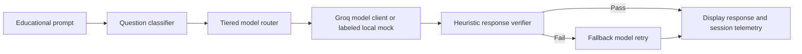

# Axiom

**AI eXcellence in Optimized Mentoring**

*Intelligence, routed with purpose.*

Axiom is a Streamlit prototype for educational AI tutoring. It classifies a question, routes it to a model tier, checks the response, retries through a fallback model when appropriate, and records routing and estimated cost telemetry for the current session.

> **Prototype status:** Groq-backed generation is optional. Without a configured API key—or when a provider request fails—the tutor explicitly marks and returns a local mock response. Analytics and cost-savings figures are session-scoped estimates, not a persistent reporting service or audited savings.

## Contents

- [Features](#features)
- [How routing works](#how-routing-works)
- [Requirements and setup](#requirements-and-setup)
- [Run the app](#run-the-app)
- [Test](#test)
- [Project structure](#project-structure)
- [Limitations and integration status](#limitations-and-integration-status)

## Features

- **Production AI Tutor** — Submit an educational prompt, see the response and selected model, and inspect verification, fallback, token, latency, and cost details.
- **Tiered model routing** — Route requests using the project classifier and fixed tier-to-model mapping.
- **Response checks and escalation** — Run heuristic response checks and retry with a higher-capability fallback model when the response fails verification.
- **Calibration Studio** — Compare the router-selected complexity tier with an expected tier. This evaluates routing agreement; it is not a benchmark of answer quality.
- **SDG Analytics** — Review request, route, token, and estimated cost metrics accumulated in the active Streamlit session.
- **Axiom visual identity** — Shared brand colors, accessible SVG lockups, browser title, and SVG page icon are applied throughout the app.

## How routing works



The current router maps complexity tiers to configured model identifiers in `core/` and `engine/`. The Groq client uses `GROQ_API_KEY`; when a live request cannot be made, the user interface labels the result as a mock rather than presenting it as a live model response. The fallback demonstration option intentionally simulates a verification failure to exercise escalation.

## Requirements and setup

- Python 3.10 or newer. The dependency manifest does not pin a Python version; the development environment used for the rebrand is Python 3.13.14.
- Dependencies in `requirements.txt`: Streamlit (`>=1.40,<2`), Groq, and python-dotenv. Groq and python-dotenv are not version-pinned there.
- A Groq API key is optional for local UI and mock-mode use; it is required for provider-backed generation.

From the repository root, create and activate a virtual environment, then install the requirements:

```powershell
py -3 -m venv .venv
.\.venv\Scripts\Activate.ps1
python -m pip install -r requirements.txt
```

For live generation, set the key in the current PowerShell session:

```powershell
$env:GROQ_API_KEY = "your-groq-api-key"
```

Alternatively, create a root `.env` file containing `GROQ_API_KEY=your-groq-api-key`. Keep the key private; do not commit `.env`.

## Run the app

```powershell
python -m streamlit run app/main.py
```

Streamlit opens the app in a browser. Choose a destination from the sidebar. The app does not require an API key to open and explore its pages; without one, generation uses the labeled mock path.

## Test

The repository uses script-style tests and does not declare a pytest or lint runner. Run the integration and router tests from the repository root:

```powershell
python tests/test_app_integration.py
python tests/test_router.py
```

To run the engine tests without making live Groq requests, run them with the model client patched to its mock path:

```powershell
python -c "import runpy; from unittest.mock import patch; tests=runpy.run_path('tests/test_engine.py', run_name='engine_tests'); mocked=patch('engine.model_client.get_groq_client', return_value=None); mocked.start(); [tests[name]() for name in tests if name.startswith('test_')]; mocked.stop()"
```

## Project structure

```text
app/
  assets/             Axiom SVG wordmark and standalone mark
  components/         Shared branding, cards, headers, and page helpers
  navigation/         Sidebar, mobile navigation, and page routing
  pages/              Welcome, tutor, calibration, analytics, and About
  state/              Streamlit session-state initialization
  styles/             Brand color tokens and shared application styles
  config.py           Axiom identity, assets, and navigation configuration
  main.py             Streamlit entry point
core/                  Classification and response-verification logic
engine/                Model client, routing, telemetry, and pricing estimates
tests/                 Script-style application, engine, and router tests
.streamlit/config.toml Streamlit theme configuration
```

Important implementation references:

- `app/config.py` defines the Axiom name, expansion, tagline, shared copy, logo paths, and page metadata.
- `app/styles/tokens.py` is the source for the brand palette: primary `#2C423F`, secondary `#4C5B61`, accent `#829191`, muted `#949B96`, and neutral `#C5C5C5`.
- `app/main.py` configures Streamlit page metadata and wires the shared theme, session state, navigation, and destination rendering.
- `engine/` contains the model client and routing/telemetry support; `core/` contains classifier and verifier behavior.

## Limitations and integration status

- **No persistent reporting backend:** request telemetry is stored in Streamlit session state. It does not persist across sessions or users and is not connected to a database or reporting API.
- **Cost figures are estimates:** model rates and the comparison baseline are configured in the project. The values are useful for demonstrating routing economics, not billing, audited savings, or a guarantee of cost reduction.
- **Calibration is routing-focused:** it compares an expected tier with the tier selected by the router; it does not measure educational correctness or response quality.
- **Verification is heuristic:** it is not a semantic safety, factuality, or curriculum-quality evaluation.
- **Provider availability varies:** model identifiers, provider access, quotas, and token limits are controlled by the configured Groq account and model availability. Provider errors may cause a clearly labeled mock response.
- **No deployment configuration is included:** the repository provides the local Streamlit launch command, but does not include a production hosting, secrets-management, or observability setup.
- **Browser metadata scope:** the app configures the Streamlit page title, icon, and About menu. It does not claim to configure Open Graph or a separate HTML meta description.

`AUDIT.md` and `HANDOFF_PERSON_3.md` are retained historical project records; they may refer to earlier names and structure. `REBRAND_AUDIT.md` documents the Axiom changes and validation for the current interface.
