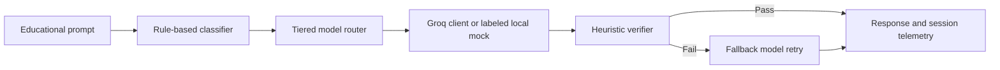

<div align="center">

# AXIOM

**AI eXcellence in Optimized Mentoring**

_Intelligence, routed with purpose._


Built for the **AICON'26 / Build FOR AI Hackathon**
Supporting **SDG 4: Quality Education** and **SDG 8: Decent Work and Economic Growth**

</div>

<!-- Add a screenshot of the Welcome or Tutor page here:
 -->

---

## Overview

Axiom is a Streamlit prototype for educational AI tutoring. Not every question needs the most expensive model, so Axiom classifies each question by complexity, routes it to a suitable model tier, checks the answer, and escalates to a stronger model only when the check fails. Each request's routing decision, token usage, latency and estimated cost are recorded for the current session.

> **Prototype status.** Groq-backed generation is optional. Without a configured API key, or when a provider request fails, the tutor returns a local mock response and labels it clearly as a mock. Analytics and savings figures are session-scoped estimates, not a persistent reporting service or audited savings.

## Quick start

```powershell
py -3 -m venv .venv
.\.venv\Scripts\Activate.ps1
python -m pip install -r requirements.txt
python -m streamlit run app/main.py
```

The app opens in your browser. No API key is needed to explore it, and without one generation uses the labeled mock path.

## Contents

- [Features](#features)
- [How routing works](#how-routing-works)
- [Setup](#setup)
- [Running the app](#running-the-app)
- [Testing](#testing)
- [Project structure](#project-structure)
- [Limitations](#limitations)
- [Team](#team)

## Features

| Workspace               | What it does                                                                                                                                                                                                  |
| ----------------------- | ------------------------------------------------------------------------------------------------------------------------------------------------------------------------------------------------------------- |
| **Production AI Tutor** | Pick a teaching scenario, adapt the prompt, and send it through classification, routing, verification and telemetry. Shows the answer, selected model, fallback decision, tokens, latency and estimated cost. |
| **Calibration Studio**  | Compares the tier the router selects with the tier you expect, using controlled examples. It evaluates routing agreement only, not answer quality.                                                            |
| **SDG Analytics**       | Shows session routing and cost estimates, exports CSV reports, and benchmarks supported models with general or ABSA/LDA rubrics.                                                                              |
| **About**               | Explains the engine, the five-step flow and the team.                                                                                                                                                         |

Other highlights:

- **Tiered routing** with a fixed tier-to-model mapping.
- **Heuristic verification** with automatic retry on a higher-capability fallback model.
- **Transparent fallback.** A demo option deliberately simulates a verification failure so you can see escalation happen.
- **Honest labeling.** Mock responses are always marked as mock.
- **Model evaluation.** SDG Analytics compares text overlap, expected formatting, latency and estimated cost against a reference rubric. Simulated outputs are visibly marked and cannot update session capability recommendations.
- **ABSA/LDA evaluation profile.** Separately scores dual-concept coverage, technical pipeline completeness, reference similarity, structural formatting, and cost/latency trade-off.
- **Axiom identity.** Shared brand tokens, SVG lockups, page title and icon across the app.

## How routing works



1. **Classify.** A rule-based classifier assigns a complexity tier.
2. **Select.** The tier is mapped to a configured Groq model.
3. **Generate.** A live response, or a labeled local mock if no key is set or the request fails.
4. **Verify.** Heuristic checks run on the response, and a failure triggers a retry on a higher-capability model.
5. **Review.** Tokens and estimated cost are recorded for the session.

Tier-to-model mappings live in `core/` and `engine/`. The Groq client reads `GROQ_API_KEY`.

## Setup

**Requirements**

- Python 3.10 or newer. The rebrand was developed on Python 3.13.
- Dependencies from `requirements.txt`: Streamlit (`>=1.40,<2`), Groq and python-dotenv. Groq and python-dotenv are not version-pinned.
- A Groq API key, which is optional for local UI and mock-mode use and required for provider-backed generation.

**Install**

```powershell
py -3 -m venv .venv
.\.venv\Scripts\Activate.ps1
python -m pip install -r requirements.txt
```

**Configure the API key (optional)**

For the current PowerShell session:

```powershell
$env:GROQ_API_KEY = "your-groq-api-key"
```

Or create a `.env` file in the repository root:

```env
GROQ_API_KEY=your-groq-api-key
```

Keep your key private and never commit `.env`.

## Running the app

```powershell
python -m streamlit run app/main.py
```

Use the sidebar to switch between Welcome, Production AI Tutor, Calibration Studio, SDG Analytics and About.

## Testing

The project uses script-style tests and does not declare a pytest or lint runner. Run these from the repository root:

```powershell
python tests/test_app_integration.py
python tests/test_router.py
python tests/test_profiler.py
```

To run the engine tests without live Groq requests, patch the model client to its mock path:

```powershell
python -c "import runpy; from unittest.mock import patch; tests=runpy.run_path('tests/test_engine.py', run_name='engine_tests'); mocked=patch('engine.model_client.get_groq_client', return_value=None); mocked.start(); [tests[name]() for name in tests if name.startswith('test_')]; mocked.stop()"
```

## Project structure

```text
app/
  assets/             Axiom SVG wordmark and standalone mark
  components/         Shared branding, cards, headers and page helpers
  navigation/         Sidebar, mobile navigation and page routing
  pages/              Welcome, tutor, calibration, analytics and About
  state/              Streamlit session-state initialization
  styles/             Brand color tokens and shared application styles
  config.py           Axiom identity, assets and navigation configuration
  main.py             Streamlit entry point
core/                 Classification, response-verification and benchmarking logic
engine/               Model client, routing, telemetry and pricing estimates
tests/                Script-style application, engine and router tests
.streamlit/           Streamlit theme configuration (config.toml)
```

**Key files**

- `app/config.py` holds the name, expansion, tagline, shared copy, logo paths and page metadata.
- `app/styles/tokens.py` is the source of truth for the brand palette.
- `app/main.py` sets page metadata and wires the theme, session state, navigation and page rendering.
- `core/` contains the classifier, verifier and benchmark profiler, and `engine/` contains the model client, router and telemetry.

**Brand palette**

| Role      | Hex       |
| --------- | --------- |
| Primary   | `#2C423F` |
| Secondary | `#4C5B61` |
| Accent    | `#829191` |
| Muted     | `#949B96` |
| Neutral   | `#C5C5C5` |

## Limitations

- **No persistent backend.** Telemetry lives in Streamlit session state, so it does not persist across sessions or users and has no database or reporting API.
- **Costs are estimates.** Model rates and the comparison baseline are configured in the project. They illustrate routing economics and are not billing data or a guarantee of savings.
- **Calibration measures routing only.** It compares expected and selected tiers, not educational correctness.
- **Benchmark scores are heuristics.** Character/token overlap and formatting checks do not establish factual correctness, semantic equivalence, safety, or learning outcomes. Only live model outputs update the session-only capability recommendation; production routing remains fixed.
- **ABSA/LDA coverage is lexical.** Its concept and pipeline checks detect rubric terms and aliases in outputs; they do not verify scientific or technical correctness.
- **Verification is heuristic.** It is not a semantic, factuality, safety or curriculum-quality check.
- **Provider availability varies.** Model identifiers, quotas and token limits depend on your Groq account. Provider errors may produce a labeled mock response.
- **No deployment setup.** Only the local Streamlit command is provided, with no hosting, secrets management or observability configuration.
- **Browser metadata.** The app sets the page title, icon and About menu. It does not configure Open Graph tags or a separate HTML meta description.

## Team

|     | Name                   | Role                   |
| --- | ---------------------- | ---------------------- |
| MJ  | Muhammad Arslan Jaffer | Backend                |
| AB  | Abdul Basit            | Frontend               |
| FA  | Fatima Asim            | Classifier and testing |

## Project records

`AUDIT.md` and `HANDOFF_PERSON_3.md` are retained historical records and may refer to earlier names and structure. `REBRAND_AUDIT.md` documents the Axiom changes and their validation.

---

<div align="center">

**Axiom** · AICON'26 / Build FOR AI Hackathon
SDG 4 Quality Education · SDG 8 Decent Work and Economic Growth

</div>
